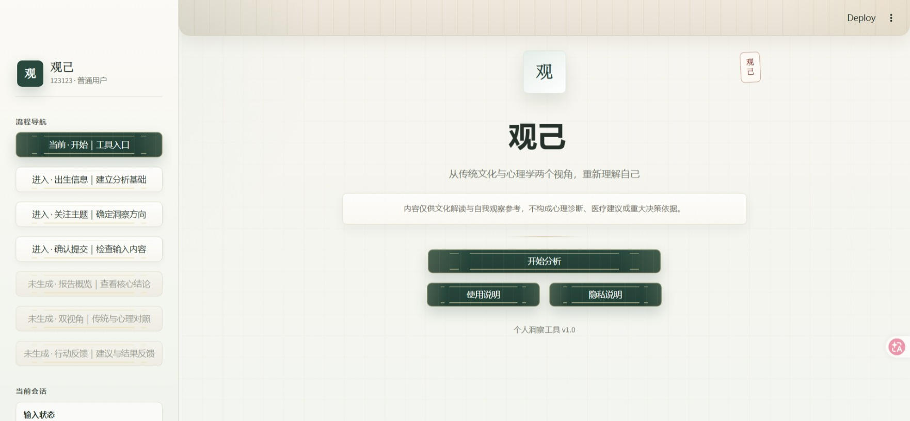
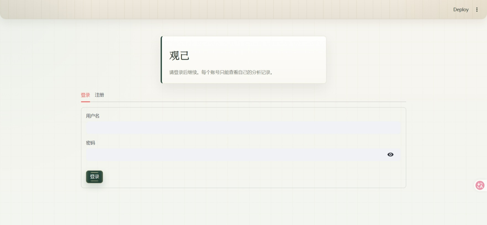
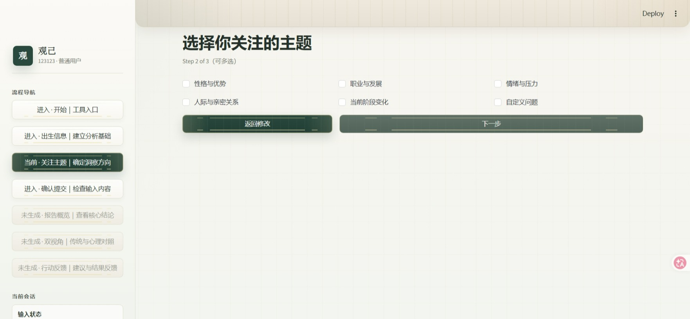

# 观己 · Bazi Trading Agents

一个基于 Streamlit 和 LangGraph 的八字文化解读与自我观察工具。用户注册后填写出生信息、选择关注主题，并使用**自己的模型服务商 API Key**生成报告。报告提供传统文化与心理学两个视角，以及可供参考的行动建议。

> 当前仓库提供可运行的代码，**尚未部署公开网站**。GitHub 仓库页面不能直接运行需要 Python 后端和模型 API 的应用。



<details>
<summary>查看更多页面截图</summary>

登录页：



关注主题：



</details>

## 目前可以做什么

- **分步填写**：出生日期、时间、地点、历法及补充说明；选择性格、职业、关系、压力等主题，也可提出自定义问题。
- **多智能体分析**：LangGraph 串联命盘、日主、十神、格局、用神、大运、传统视角、心理学视角和综合分析环节。
- **查看报告**：报告概览、传统与心理学双视角、行动建议和反馈。
- **自带 API Key**：支持硅基流动、OpenAI、Anthropic；服务商和模型由应用预设，用户在每次分析时输入自己的 Key。
- **账号与记录隔离**：登录后只显示当前账号的记录。分析记录默认关闭；用户主动勾选后才保存本次出生资料与结果。
- **下载报告**：普通用户可下载简版 Markdown、Word、PDF；管理员另有专业版和 JSON 导出。
- **基础限流**：单账号每小时最多 6 次，单进程每小时最多 60 次，最多同时处理 3 次分析。

## 多智能体框架如何工作

项目把一次分析拆成多个职责明确的节点，由 [`BaziAnalysisGraph`](bazi_graph/bazi_analysis_graph.py) 使用 LangGraph 编排。每个节点读取共享状态中已经生成的报告，构造自己的提示词，调用**用户本次选择的同一个大模型**，再把结果写回状态。这里的“智能体”指分工不同的分析角色，并不代表为每个角色部署一套独立模型。


### 九个分析角色

| 阶段 | 角色 | 输入与职责 | 写入的状态 |
| --- | --- | --- | --- |
| 基础 | 命盘计算师 | 根据出生资料提示模型生成四柱、日主、藏干、大运等基础报告，并标注不确定之处 | `chart_report` |
| 基础 | 日主分析师 | 结合命盘分析日主五行、阴阳、强弱及相关依据 | `day_master_report` |
| 基础 | 十神分析师 | 结合命盘和日主报告梳理十神分布、强弱与组合 | `ten_gods_report` |
| 基础 | 格局分析师 | 综合月令、透干、藏干和十神信息解释格局 | `pattern_report` |
| 基础 | 用神分析师 | 参考扶抑、调候、通关、病药等思路讨论用神和忌神 | `useful_god_report` |
| 基础 | 大运分析师 | 结合前序报告讨论大运与当前人生阶段的主题 | `luck_cycle_report` |
| 交叉讨论 | 传统命理分析师 | 根据基础报告提出传统视角，并回应上一轮心理学观点 | `bazi_debate_state` |
| 交叉讨论 | 心理学转译分析师 | 将传统概念转译成行为与成长议题，并指出解释边界 | `bazi_debate_state` |
| 汇总 | 综合分析师 | 汇总基础报告和双视角讨论，生成面向用户的最终报告 | `final_analysis` |

前六个角色按固定顺序运行，因此后续节点可以引用前面节点的输出。传统命理与心理学角色交替发言，讨论状态记录两方观点、完整历史和发言次数。默认配置为 **3 轮交替讨论**，达到配置的轮数后进入综合分析；轮数可通过 `MAX_DEBATE_ROUNDS` 调整。综合分析提示词要求列出命盘摘要、传统分析、心理学转译、当前阶段策略、行动建议和风险边界，并对分歧保留说明。

按默认 3 轮计算，一次完整分析通常需要 **13 次模型调用**：6 个基础节点、两方各 3 次发言、1 次综合生成。实际耗时和费用取决于服务商、模型、输入长度及其计费方式。网页端的模型与接口地址由服务端预设，访客只能选择提供商并填写本次使用的 Key。

### 状态、质量检查与记忆

共享状态定义在 [`utils/bazi_states.py`](utils/bazi_states.py)。它保存出生资料、分析日期、六份阶段报告、双方讨论历史和最终报告。网页通过进度回调展示已完成的分析阶段；最终报告再拆成概览、双视角和行动建议页面。

综合报告生成后，[`utils/quality.py`](utils/quality.py) 会使用规则检查**结构、语言、伦理边界、可行动性和前后表述一致性**，生成分数与提示。这是文本规则检查，不能证明四柱计算或心理解释正确。框架代码支持按配置进行低分重写；当前网页分析明确关闭了额外的大模型评审与自动重写，以控制请求次数。

项目还包含 [`BaziAnalysisMemory`](utils/memory.py) 案例检索模块：传统与心理学角色可以从各自的记忆目录读取相似案例，检索时会考虑关键词、结构特征和质量筛选。**当前公开网页流程为每次分析使用临时记忆目录，并关闭嵌入检索**；因此不同访客的案例不会作为共享记忆进入后续分析。记忆模块可供单独使用框架时扩展，但网页目前没有自动把新分析加入长期案例库。

这套流程的价值是把每一步的输入、输出和视角分工明确地组织起来，便于查看中间报告、调整提示词和定位问题。多个节点仍可能继承上游错误；尤其命盘计算本身也由大模型生成，不能把多智能体讨论当作事实校验。

## 本地启动

建议使用 Python 虚拟环境。已经创建 `bazi-trading-agents` Conda 环境的用户，在 PowerShell 中运行：

```powershell
cd E:\NSSC\findwork\code\bazi-trading-agents
conda activate bazi-trading-agents
pip install -r requirements.txt
streamlit run web_app.py
```

也可以先克隆本仓库，再进入克隆后的目录运行后三条命令：

```powershell
git clone https://github.com/Mengyaolv/bazi-trading-agents.git
cd bazi-trading-agents
```

终端显示 `Local URL` 后，在浏览器打开该地址，通常是 `http://localhost:8501`。首次使用先注册账号；生成分析前选择服务商并输入该服务商的有效 API Key。停止服务时在终端按 `Ctrl+C`。

网页模式无需把自己的 API Key 写入 `.env`。如需调整运行参数，可参考 [`.env.example`](.env.example)；**不要提交 `.env`、真实 Key、`data/`、`results/` 或 `memory/` 中的私人内容**。

## 使用流程

1. 注册或登录。
2. 填写出生信息，选择关注主题。
3. 确认资料，选择模型服务商并输入自己的 API Key。按需勾选“允许记录本次分析结果”。
4. 查看报告概览、双视角分析及行动建议，并下载报告。

API Key 会通过应用服务器发送给所选模型服务商，用于当前分析；应用不将 Key 写入分析记录。出生资料和相关问题也会发送给模型服务商。若选择保存记录，服务器会保存出生资料与分析结果；账号数据保存在 `data/users.json`。请只在信任的服务实例上填写资料与 Key。

## 项目结构

```text
web_app.py             Streamlit 网页入口
bazi_graph/             LangGraph 分析流程
bazi_agents/            各分析智能体
utils/                  登录、访问限制、导出、记录与质量检查等工具
prompts/                分析提示词
docs/screenshots/       README 页面截图
PUBLIC_DEPLOYMENT.md    公开部署说明
```

## 公开部署说明

当前仓库上传到 GitHub 后，访客只能查看代码。要提供可访问的网站，需要另行部署一个能持续运行 Python 的服务，并用 HTTPS 对外提供访问。部署步骤和数据持久化要求见 [`PUBLIC_DEPLOYMENT.md`](PUBLIC_DEPLOYMENT.md)。`PUBLIC_MODE=1` 用于公开环境；`data/users.json` 需要持久化，只有在允许保留分析记录时才需要持久化 `results/`。

## 使用边界与来源

当前“四柱排盘”环节由大模型生成，**不是经过独立历法程序校验的确定性计算**，可能出现排盘或解读错误。所有内容仅供文化解读与自我观察参考，不构成心理诊断、医疗、法律、投资或重大人生决策建议。

本项目基于 [brucewu905/bazi-trading-agents](https://github.com/brucewu905/bazi-trading-agents) 改造；原框架作者为 Wu Zhongpei。请保留原项目来源，并遵守上游许可与署名要求。
